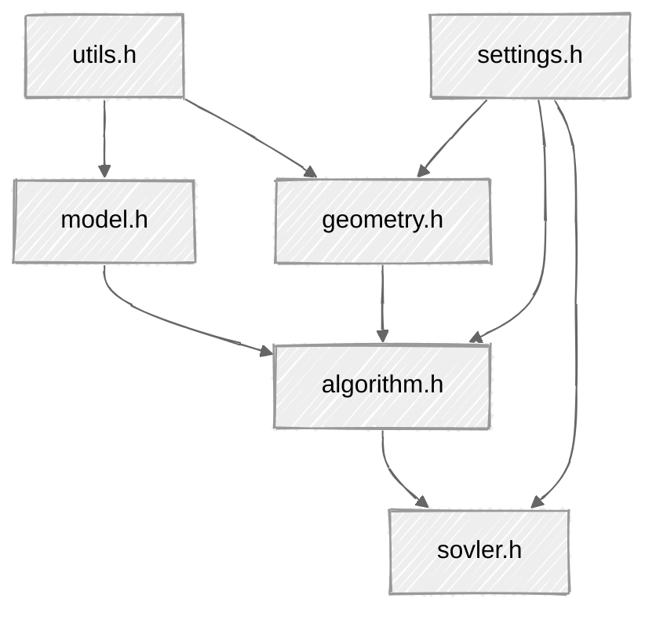
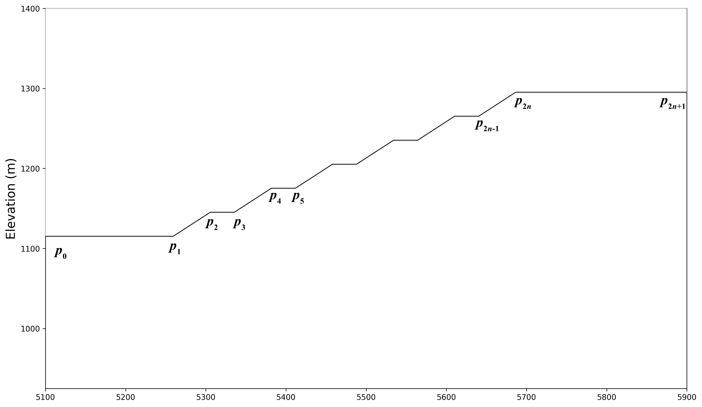

## 读取数据格式

- 使用 json 格式保存计算所需剖面数据

## 整体框架如下所示：

## 条分法的实现逻辑

- 在插值时生成 n+2 个点(包含入口点和出口点), 切条的宽度为 1/(n+1), 如果不包含入口点和出口点, 个数为 slicesNum, 因此在插值时的插值点数量为 slicesNum+2
- 所有的点偏移半个 dx 宽度,因此返回插值结果时, 移除最后一个(出口点), 因为越界了
- 最终生成的条带数量为 n+1 个
- 最后在计算安全系数时, 因为要考虑条带底部的斜率, 条带与紧邻的下一个条带的斜率最为本条带的底边斜率, 此时最后一个条带无法形成斜率, 因此舍去掉最后一个条带, 实际参与运算的条带数量为 n 个

## 边坡形态

边坡形态的表达方式

$$

\begin{array}{c}
p_{0}-->\\
p_{1}-->\\
p_{2}-->\\
p_{3}-->\\
p_{4}-->\\
p_{5}-->\\
\vdots\\
p_{2n+1}-->
\end{array}

\left[
\begin{array}{cc}
x_0 & y_0  \\
x_1 & y_1 \\
x_2 & y_2 \\
x_3 & y_3 \\
x_4 & y_4 \\
x_5 & y_5 \\
\vdots & \vdots\\
x_{2n+1} & y_{2n+1} \\
\end{array}
\right]

\left.\vphantom{
\begin{array}{c}
a_{11}\\
a_{21}\\
a_{11}\\
a_{21}\\
a_{11}\\
a_{21}\\
\cdots\\
a_{11}
\end{array}}\right\}
{2n+2}
$$

其中，n为台阶个数

- 线段$p_0p_1$为最下层台阶（从下往上数第1层台阶）坡底，也是**整个边坡的坡底**
- 线段$p_1p_2$为最下层台阶坡面
- 线段$p_2p_3$为最下层台阶坡顶，也是次最下层台阶（从下往上数第2层台阶）的坡底
- 线段$p_3p_4$为次最下层台阶坡面
- 线段$p_4p_5$为次最下层台阶坡顶，也是次次最下层台阶（从下往上数第3层台阶）的坡底
- ……
- 线段$p_{2n}p_{2n+1}$为最顶层台阶的坡顶，也是**整个边坡的坡顶**
  边坡形态如下图所示

## Notes

- 关于==多个软弱层/断层的处理方法==，目前还没有特别好的想法

## 参考资料

- https://help.geostru.eu/slope/en/index.html
- https://www.geoengineer.org/education/slope-stability/slope-stability-introduction-to-the-method-of-slices
- https://www.geoengineer.org/education/slope-stability/slope-stability-the-bishop-method-of-slices
- https://www.geoengineer.org/education/slope-stability/slope-stability-the-janbu-method
- https://files.seequent.com/PDFs/Geostudio-Stability%20Modeling-Oct2022.pdf
