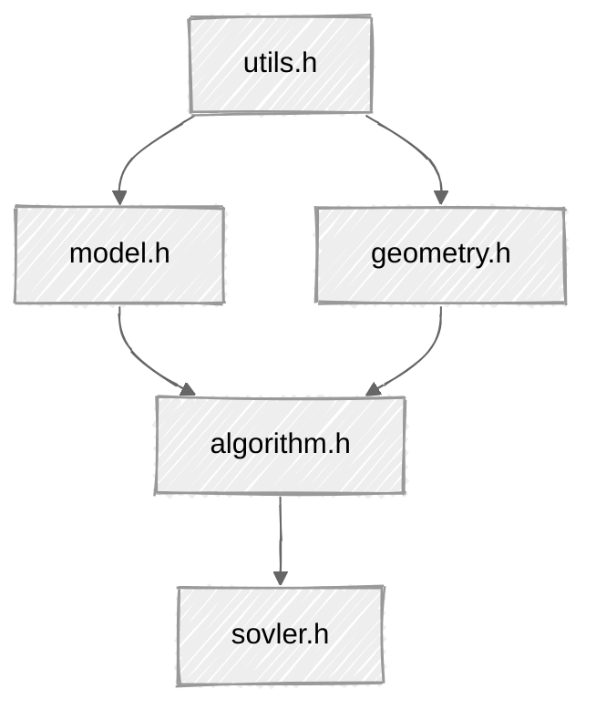
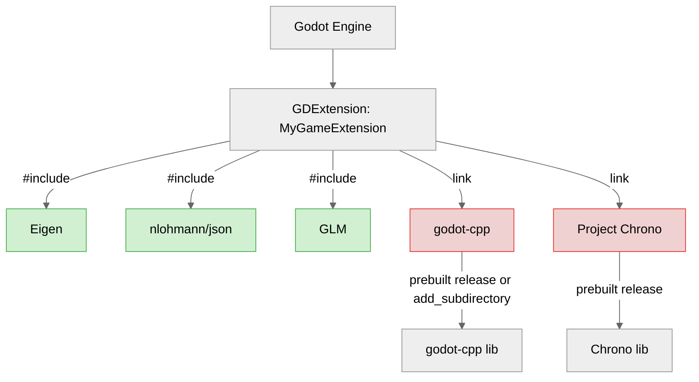

## 读取数据格式

- 使用 json 格式保存计算所需剖面数据

- 整体框架如下所示：

## 条分法的实现逻辑

- 在插值时生成 n+2 个点(包含入口点和出口点), 切条的宽度为 1/(n+1), 如果不包含入口点和出口点, 个数为 slicesNum, 因此在插值时的插值点数量为 slicesNum+2
- 所有的点偏移半个 dx 宽度,因此返回插值结果时, 移除最后一个(出口点), 因为越界了
- 最终生成的条带数量为 n+1 个
- 最后在计算安全系数时, 因为要考虑条带底部的斜率, 条带与紧邻的下一个条带的斜率最为本条带的底边斜率, 此时最后一个条带无法形成斜率, 因此舍去掉最后一个条带, 实际参与运算的条带数量为 n 个

