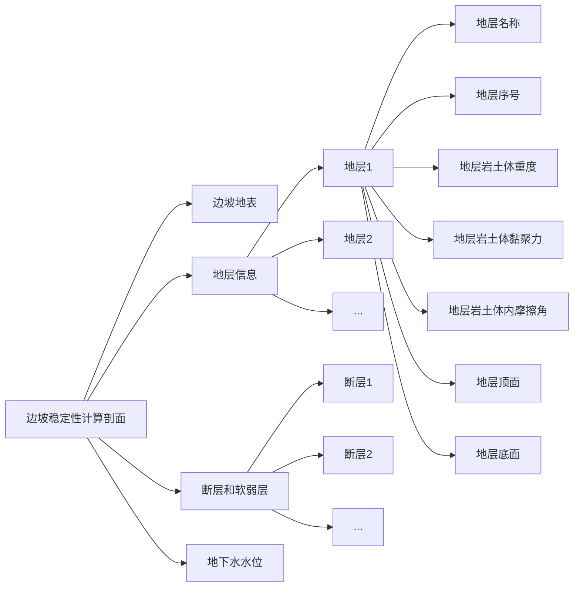

- section.json 文件

```json
{
  "slope_shape": [
    [ x_0,  y_0 ],
    [ x_1,  y_1 ],
    [ x_2,  y_2 ],
    [ ...,  ... ],
    [x_2n+1, y_2n+1]
  ],
  "stratum": [
    {
      "strata_name": "sandstone",
      "strata_idx": 0,
      "density": 17.1,
      "cohesion": 15.7,
      "friction_angle": 18.4,
      "strata_upper_bound": [
        [ x_0,  y_0 ],
        [ x_1,  y_1 ],
        [ ...,  ... ],
      ],
      "strata_lower_bound": [
        [ x_0,  y_0 ],
        [ x_1,  y_1 ],
        [ ...,  ... ],
      ]
    },
    {
      "strata_name": "shale",
      "strata_idx": 1,
      "density": 16.7,
      "cohesion": 28.5,
      "friction_angle": 22.1,
      "strata_upper_bound": [
        [ x_0,  y_0 ],
        [ x_1,  y_1 ],
        [ ...,  ... ],
      ],
      "strata_lower_bound": [
        [ x_0,  y_0 ],
        [ x_1,  y_1 ],
        [ ...,  ... ],
      ]
    },
    {
      ...
    }
  ],
  "faults": [],
  "water_level": []
}
```

- launch 文件

```json
{
  "version": "0.2.0",
  "configurations": [
    {
      "name": "CMake Debug",
      "type": "cppdbg",
      "request": "launch",
      "program": "${command:cmake.launchTargetPath}",
      "cwd": "${workspaceFolder}",
      "args": [],
      "stopAtEntry": false,
      "environment": [],
      "externalConsole": false,
      "MIMode": "gdb",
      "logging": {
        "engineLogging": false
      },
      "setupCommands": [
        {
          "description": "为 gdb 启用整齐打印",
          "text": "-enable-pretty-printing",
          "ignoreFailures": true
        }
      ]
    }
  ]
}
```

- settings.json file

```json
{
  "cmake.configureSettings": {
    "CMAKE_TOOLCHAIN_FILE": "c:/src/vcpkg/scripts/buildsystems/vcpkg.cmake"
  },
  "files.associations": {
    "*.js": "javascript",
    "vector": "cpp",
    "algorithm": "cpp",
    "any": "cpp",
    "array": "cpp",
    "atomic": "cpp",
    "bit": "cpp",
    "cctype": "cpp",
    "charconv": "cpp",
    "chrono": "cpp",
    "clocale": "cpp",
    "cmath": "cpp",
    "codecvt": "cpp",
    "compare": "cpp",
    "complex": "cpp",
    "concepts": "cpp",
    "cstddef": "cpp",
    "cstdint": "cpp",
    "cstdio": "cpp",
    "cstdlib": "cpp",
    "cstring": "cpp",
    "ctime": "cpp",
    "cwchar": "cpp",
    "deque": "cpp",
    "exception": "cpp",
    "filesystem": "cpp",
    "format": "cpp",
    "forward_list": "cpp",
    "fstream": "cpp",
    "functional": "cpp",
    "initializer_list": "cpp",
    "iomanip": "cpp",
    "ios": "cpp",
    "iosfwd": "cpp",
    "iostream": "cpp",
    "istream": "cpp",
    "iterator": "cpp",
    "limits": "cpp",
    "list": "cpp",
    "locale": "cpp",
    "map": "cpp",
    "memory": "cpp",
    "new": "cpp",
    "numeric": "cpp",
    "optional": "cpp",
    "ostream": "cpp",
    "queue": "cpp",
    "ranges": "cpp",
    "ratio": "cpp",
    "set": "cpp",
    "span": "cpp",
    "sstream": "cpp",
    "stdexcept": "cpp",
    "stop_token": "cpp",
    "streambuf": "cpp",
    "string": "cpp",
    "system_error": "cpp",
    "thread": "cpp",
    "tuple": "cpp",
    "type_traits": "cpp",
    "typeinfo": "cpp",
    "unordered_map": "cpp",
    "utility": "cpp",
    "valarray": "cpp",
    "xfacet": "cpp",
    "xhash": "cpp",
    "xiosbase": "cpp",
    "xlocale": "cpp",
    "xlocbuf": "cpp",
    "xlocinfo": "cpp",
    "xlocmes": "cpp",
    "xlocmon": "cpp",
    "xlocnum": "cpp",
    "xloctime": "cpp",
    "xmemory": "cpp",
    "xstring": "cpp",
    "xtr1common": "cpp",
    "xtree": "cpp",
    "xutility": "cpp",
    "cwctype": "cpp",
    "memory_resource": "cpp",
    "random": "cpp",
    "string_view": "cpp",
    "numbers": "cpp",
    "text_encoding": "cpp",
    "variant": "cpp"
  }
}
```
