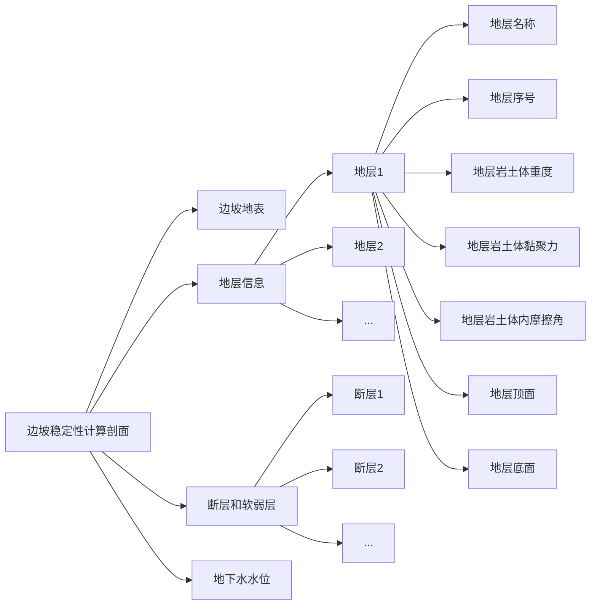

```json
{
  "slope_shape": [
    [ x_0,  y_0 ],
    [ x_1,  y_1 ],
    [ x_2,  y_2 ],
    [ ...,  ... ],
    [x_2n+1, y_2n+1]
  ],
  "stratum": [
    {
      "strata_name": "sandstone",
      "strata_idx": 0,
      "density": 17.1,
      "cohesion": 15.7,
      "friction_angle": 18.4,
      "strata_upper_bound": [
        [ x_0,  y_0 ],
        [ x_1,  y_1 ],
        [ ...,  ... ],
      ],
      "strata_lower_bound": [
        [ x_0,  y_0 ],
        [ x_1,  y_1 ],
        [ ...,  ... ],
      ]
    },
    {
      "strata_name": "shale",
      "strata_idx": 1,
      "density": 16.7,
      "cohesion": 28.5,
      "friction_angle": 22.1,
      "strata_upper_bound": [
        [ x_0,  y_0 ],
        [ x_1,  y_1 ],
        [ ...,  ... ],
      ],
      "strata_lower_bound": [
        [ x_0,  y_0 ],
        [ x_1,  y_1 ],
        [ ...,  ... ],
      ]
    },
    {
      ...
    }
  ],
  "faults": [],
  "water_level": []
}
```

- launch文件
```json
{
    "version": "0.2.0",
    "configurations": [
        {
            "name": "CMake Debug",
            "type": "cppdbg",
            "request": "launch",
            "program": "${command:cmake.launchTargetPath}",
            "cwd": "${workspaceFolder}",
            "args": [],
            "stopAtEntry": false,
            "environment": [],
            "externalConsole": false,
            "MIMode": "lldb",
            "logging": {"engineLogging":false}
        }
    ]
}

```